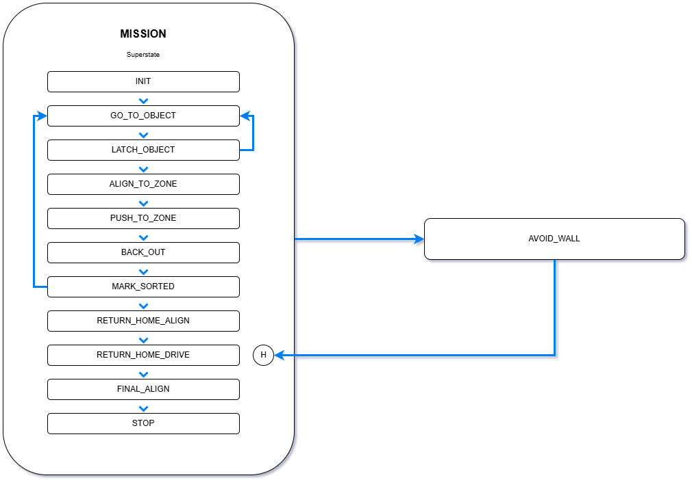
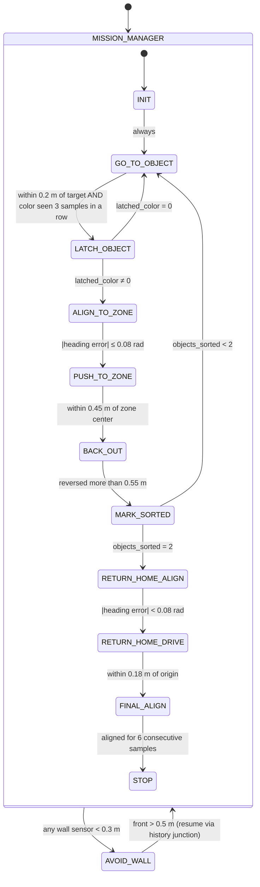
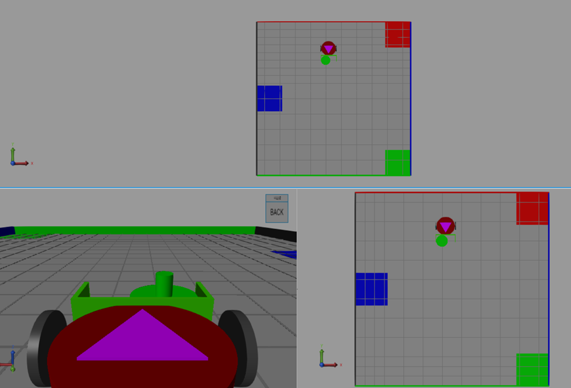
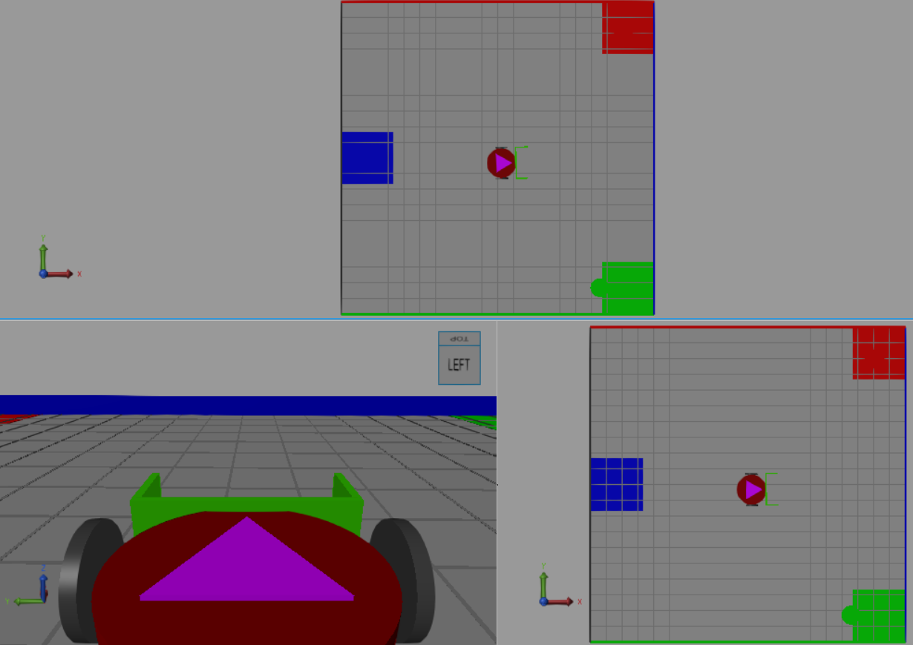
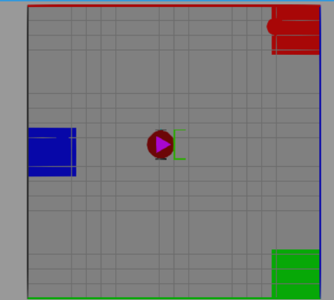

# Autonomous Object Sorting with a Mobile Robot

**ME 598 – Introduction to Robotics · Final Project (R6)**
Model: `ME598A_Final_Project_R6.slx` (MATLAB/Simulink, Robotics Playground)

This README covers the control architecture of our sorting robot: the Stateflow state machine, what each state does, the conditions that move the robot between states, and the algorithms running inside them.

The task, in one line: the robot starts at $[-1.5, -1.5]$ facing $+x$, finds the two colored objects at $[0, -1.5]$ and $[0, 1.5]$, identifies their colors, pushes each into its matching zone, and then returns to $[0, 0]$ and stops — without touching the walls, and for any of the six color arrangements, with no changes to settings between runs.

---

## 1. Control Architecture

We implemented the controller as a single **hierarchical Stateflow chart**. It has two top-level states:

- **`MISSION_MANAGER`** – a superstate holding the normal, sequential mission (find → identify → push → repeat → go home).
- **`AVOID_WALL`** – a safety state that can interrupt the mission from *any* sub-state.

The interrupt is a transition drawn from the border of `MISSION_MANAGER`, so it is checked on every time step regardless of which mission state is active. When the wall is cleared, `AVOID_WALL` returns through a **history junction** inside `MISSION_MANAGER`, so the robot resumes exactly the sub-state it was in (for example, still pushing the same object to the same zone) instead of restarting the mission.

*Figure 1 – Stateflow chart of the sorting controller.*

### State diagram

### Inputs and outputs

| Signal | Direction | Use |
|---|---|---|
| `xPose`, `yPose`, `tPose` | in | Odometry pose (position and heading) |
| `Red_Distance`, `Green_Distance`, `Blue_Distance` | in | Color detector — `NaN` when that color is not in view |
| `Left_Distance`, `Front_Distance`, `Right_Distance` | in | Wall distance sensors — `NaN` when nothing is in range |
| `left_speed`, `right_speed` | out | Differential-drive wheel speed commands |

Every state writes both wheel commands, so there is always exactly one behavior driving the robot.

---

## 2. States

| State | What it does | Exit condition |
|---|---|---|
| `INIT` | Resets all mission variables: sort counters and flags, target, latched color, zone, wheel speeds. | Immediately → `GO_TO_OBJECT` |
| `GO_TO_OBJECT` | Drives to the current object's known position while watching the color detector. | Close to the object **and** a stable color reading |
| `LATCH_OBJECT` | Stops, locks in the detected color, and looks up that color's zone. | Valid color → `ALIGN_TO_ZONE`; otherwise back to `GO_TO_OBJECT` |
| `ALIGN_TO_ZONE` | Turns in place until the robot faces the zone, with the object in front of the plow. | Heading error ≤ 0.08 rad |
| `PUSH_TO_ZONE` | Drives forward at constant speed with heading correction, pushing the object. | Within 0.45 m of the zone center |
| `BACK_OUT` | Reverses straight back to release the object. | Moved more than 0.55 m from where reversing began |
| `MARK_SORTED` | Records which color has been sorted and increments the counter. | One sorted → next object; two sorted → go home |
| `RETURN_HOME_ALIGN` | Turns in place to face the origin. | Heading error < 0.08 rad |
| `RETURN_HOME_DRIVE` | Drives to $[0,0]$ with distance-scaled speed. | Within 0.18 m of the origin |
| `FINAL_ALIGN` | Rotates to face $+x$ (heading 0) and waits for it to settle. | Within 0.15 rad for 6 samples in a row |
| `STOP` | Holds both wheels at zero. | Terminal |
| `AVOID_WALL` | Overrides the mission and steers away from the nearest wall. | Front clearance > 0.5 m → resume via history |

---

## 3. Algorithms

### 3.1 Odometry-based point navigation

Every "go somewhere" state (`GO_TO_OBJECT`, `ALIGN_TO_ZONE`, `PUSH_TO_ZONE`, `RETURN_HOME_*`) uses the same geometry. For a target $(x_t, y_t)$:

$$
dx = x_t - x, \qquad dy = y_t - y, \qquad d = \sqrt{dx^2 + dy^2}
$$

$$
\beta = \text{atan2}(dy, dx)
$$

$$
e_\theta = \text{atan2}\big(\sin(\beta - \theta),\ \cos(\beta - \theta)\big)
$$

Wrapping the error with `atan2(sin, cos)` keeps $e_\theta$ in $[-\pi, \pi]$. Without it, a target just across the $\pm\pi$ boundary would make the robot spin almost a full turn the long way round; with it, the robot always takes the shorter turn.

The wheel commands are a forward speed $v$ plus a differential steering term $c$:

$$
c = K \, e_\theta, \qquad c \in [-\alpha v,\ \alpha v]
$$

$$
\text{left} = v - c, \qquad \text{right} = v + c
$$

Clamping $c$ to a fraction $\alpha$ of the forward speed means both wheels keep turning forward while driving. The robot curves toward the target rather than pivoting sharply, which matters most when it is pushing an object.

### 3.2 Approaching the object (`GO_TO_OBJECT`)

Object targets are fixed by the arena layout. The robot goes to the south object $(0, -1.5)$ first, since it is closer to the start position, and then to the north object $(0, 1.5)$.

- **Speed scheduling:** $v = \min(28,\ 10 + 16d)$, with a floor of 8. The robot moves quickly when far away and slows on approach, so it arrives at the object without knocking it out of place.
- **Steering:** $K = 22$ (`TURN_GAIN`), clamped at $0.65v$.

### 3.3 Color recognition and latching

The color detector has a narrow field of view and can flicker at the edge of its range, so a single reading is not trusted. On every step of `GO_TO_OBJECT`:

1. Check the red, green and blue channels in that order. A channel counts as "seen" if it is not `NaN` **and** that color has not already been sorted. Ignoring already-sorted colors stops the robot from re-detecting the first object sitting in its zone while it heads to the second one.
2. If a color is seen, increment `stable_color_count`; otherwise reset it to 0.

The robot only moves to `LATCH_OBJECT` when **both** of these hold:

- it is within `OBJECT_CAPTURE_RADIUS = 0.2 m` of the object position, and
- the color has been seen for `COLOR_LATCH_COUNT = 3` consecutive samples.

In `LATCH_OBJECT` the color is stored and mapped to a zone:

| Color | Code | Zone center |
|---|---|---|
| Red | 1 | $(2.0,\ 2.0)$ |
| Green | 2 | $(2.0,\ -2.0)$ |
| Blue | 3 | $(-2.0,\ 0.0)$ |

If the latch somehow ends up empty (code 0), the robot falls back to `GO_TO_OBJECT` rather than pushing toward a meaningless target.

Because color identification and zone selection are driven entirely by the sensor reading, the same chart handles all six color arrangements with no changes.

### 3.4 Aligning and pushing (`ALIGN_TO_ZONE` → `PUSH_TO_ZONE`)

**Alignment** is an in-place rotation ($\text{left} = -s$, $\text{right} = +s$) with $s = 22\,e_\theta$. Near the target heading, the proportional command becomes too small to overcome friction, so we enforce a **minimum turn speed of 5** whenever the error is still above `ALIGN_TOL = 0.08 rad`. This prevents the robot from stalling just short of alignment.

Rotating in place before pushing means that once the push starts, the robot, the object and the zone are all roughly on one line. Correcting heading while already pushing tends to make the object slide off the plow.

**Pushing** uses a constant `BASE_SPEED = 50` with steering gain `DRIVE_GAIN = 14`. The correction is clamped tighter here, at $0.6v$, so the robot only makes small heading adjustments while the object is against the plow. The push ends when the robot is within `ZONE_REACH_RADIUS = 0.45 m` of the zone center. Since the robot's own position is behind the object, this puts the object's center inside the shaded zone.

### 3.5 Releasing the object (`BACK_OUT` → `MARK_SORTED`)

On entry, `BACK_OUT` stores the current position. The robot then reverses in a straight line at `BACK_SPEED = 16` until it is more than `BACKOUT_DIST = 0.55 m` from that point. Reversing straight back, with no rotation, leaves the object where it was placed instead of dragging it out of the zone.

`MARK_SORTED` then sets the flag for the latched color (`red_sorted`, `green_sorted` or `blue_sorted`), increments `objects_sorted`, and clears the color latch. The flags serve two purposes: they decide whether to fetch the second object or go home, and they let the detector ignore colors that have already been sorted (Section 3.3).

### 3.6 Returning home (`RETURN_HOME_ALIGN` → `RETURN_HOME_DRIVE` → `FINAL_ALIGN` → `STOP`)

1. **Align:** rotate in place toward $(0,0)$ with gain 20 and a minimum turn speed of 4, until $|e_\theta| < 0.08$ rad.
2. **Drive:** the same point-navigation law as before, with $v = \min(24,\ 10 + 18d)$, a floor of 6, steering gain 14 and a clamp of $0.6v$. The exit happens at `HOME_RADIUS = 0.18 m`.
3. **Final align:** rotate to heading 0 using
   $e = \text{atan2}(\sin(0-\theta), \cos(0-\theta))$, with gain `FINAL_TURN_GAIN = 18`. A counter tracks how many consecutive samples have $|e| < 0.15$ rad. The robot only moves on to `STOP` after **6 in a row**, so it does not stop while still oscillating through the target heading.
4. **Stop:** both wheel commands are held at 0 for the rest of the simulation.

### 3.7 Wall avoidance (`AVOID_WALL`)

**Entry:** the chart enters `AVOID_WALL` from anywhere in the mission as soon as any sensor reads below `WALL_ENTER = 0.3 m`. `NaN` readings mean "nothing in range" and are ignored.

**Choosing a direction once:** on entry, `NaN` side readings are replaced with a large value (`INF_DIST = 999`), and the robot picks the more open side (`escape_dir = +1` for left, `-1` for right). The direction is fixed at entry rather than recomputed every step. Keeping it fixed stops the robot from flip-flopping left and right in corners, where both sides can read almost the same.

**Reactive steering**, applied in priority order:

| Condition | Command (left, right) | Effect |
|---|---|---|
| Front < 0.5 m | (−16, 12) if escaping left, (12, −16) if escaping right | Pivot toward the open side |
| Left < 0.5 m | (14, −14) | Spin right, away from the left wall |
| Right < 0.5 m | (−14, 14) | Spin left, away from the right wall |
| Otherwise | (0, 0) | Hold |

**Hysteresis:** the robot enters at 0.3 m but only exits once the front reads above `WALL_EXIT = 0.5 m`. This gap stops it from bouncing in and out of avoidance at a single threshold. On exit, control returns through the **history junction** to whichever mission state was interrupted. Because all targets live in variables (`target_x/y`, `zone_x/y`), the robot simply recomputes its heading error from its new pose and carries on.

The state also keeps a debounce counter (`wall_clear_count`) that tracks consecutive samples where all three sensors are clear. The current exit guard only checks the front sensor; the counter is there if a stricter all-clear exit is needed.

---

## 4. Tuned Parameters

| Parameter | Value | Purpose |
|---|---|---|
| `TURN_GAIN` | 22 | Steering gain while approaching objects, and turn gain for zone alignment |
| `DRIVE_GAIN` | 14 | Steering gain while pushing |
| `BASE_SPEED` | 50 | Constant push speed |
| `BACK_SPEED` | 16 | Reverse speed in `BACK_OUT` |
| `ALIGN_TOL` | 0.08 rad | Heading tolerance before pushing |
| `OBJECT_CAPTURE_RADIUS` | 0.2 m | How close to the object before latching color |
| `COLOR_LATCH_COUNT` | 3 | Consecutive detections required to latch a color |
| `ZONE_REACH_RADIUS` | 0.45 m | Robot distance to zone center that ends the push |
| `BACKOUT_DIST` | 0.55 m | Reverse distance after a push |
| `HOME_RADIUS` | 0.18 m | Arrival radius at the origin |
| `FINAL_TURN_GAIN` | 18 | Gain for the final heading correction |
| `FINAL_ALIGN_TOL` | 0.15 rad | Final heading tolerance |
| `FINAL_SETTLE_COUNT` | 6 | Consecutive aligned samples before stopping |
| `WALL_ENTER` | 0.3 m | Wall distance that triggers avoidance |
| `WALL_EXIT` | 0.5 m | Front clearance needed to resume the mission |
| `INF_DIST` | 999 | Substitute for `NaN` (no wall in range) |

---

## 5. Arena Screenshots

*The robot moving between the object positions and their drop-off zones.*

*The green object being deposited in its zone at (2, −2).*

*The robot stopped at the origin after sorting the blue and red objects.*
